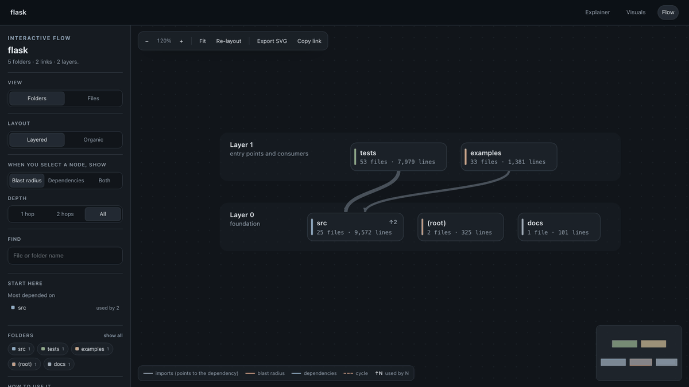

# explaincode

**See how any codebase fits together, and what breaks if you change a file.**

One command turns a repo into three offline pages: a plain-English explainer, architecture diagrams, and an interactive dependency graph you can click through. Python 3 only, no packages to install, nothing leaves your machine.

[](LICENSE)
[](#quick-start)
[](#how-it-works)



*Above: explaincode run on [Flask](https://github.com/pallets/flask). 114 files mapped in under a second.*

## Quick start

```bash
git clone https://github.com/splashxmoon/explaincode
python3 explaincode/codebase-deep-dive/scripts/deep_dive.py path/to/your/repo --out /tmp/deep-dive
open /tmp/deep-dive/explainer.html
```

On Linux use `xdg-open`, on Windows `start`. Works with the `python3` that ships with macOS.

## What you get

| Page | What it shows |
| --- | --- |
| `explainer.html` | What the project is made of, how it is layered, where to start reading, and what to watch (cycles, the most depended-on file). |
| `index.html` | Architecture as a top-to-bottom dependency flow, a change-risk map, a folder treemap, the language mix and hotspots. |
| `flow.html` | A draggable, zoomable graph. Click a file to see its blast radius, shift-click another to trace the import path between them, double-click a folder to open it, export SVG, or copy a link to the exact view. |
| `map.json` | The raw numbers, for scripts and agents. |

Every view is a URL, so you can paste a link to "what depends on `src/auth.ts`" in a PR or chat:

```
flow.html#view=file&focus=src%2Fauth.ts
```

Add `&mode=up` for what it depends on instead, or `&trace=<other file>` for the import path between the two.

## Use it as an agent skill

`codebase-deep-dive/` is a ready-made skill ([SKILL.md](codebase-deep-dive/SKILL.md)). Drop it into Claude Code and ask it to "deep dive this repo" or "what breaks if I change X":

```bash
cp -r explaincode/codebase-deep-dive ~/.claude/skills/
```

The agent runs the scan, reads `map.json`, explains the code in chat from real numbers, and links you to the exact graph view for each answer.

## How it works

- Reads every file once and follows static imports: `import`, `from ... import`, `require()`, `export ... from`, including ESM TypeScript (`./x.js` → `x.ts`) and imports wrapped over several lines.
- Groups files into dependency layers (foundations at the bottom, entry points at the top) and finds cycles.
- Writes standalone HTML: scripts and styles are inlined, no network requests, no tracking.

**Limits.** Imports are followed for Python and JavaScript/TypeScript; other languages get size and language stats only. Dynamic imports, path aliases (`@/…`) and framework conventions such as file-based routing aren't followed. `node_modules`, virtualenvs, build output, hidden folders and files over 1 MB are skipped.

## Also in this repo

- [`buildwatch/`](buildwatch): diff two builds, binaries or packages and flag new URLs, IPs and secret-looking strings. Handy before you ship a release.
- [`gitwrapped/`](gitwrapped): a year in review for your git history, with a shareable SVG card.

Both are single Python files with no dependencies.

## Tests

```bash
cd codebase-deep-dive && python3 -m unittest -v tests/test_deep_dive.py
cd buildwatch && python3 -m unittest -v test_buildwatch
```

## License

[MIT](LICENSE). Made by the people behind [Friday](https://github.com/splashxmoon/friday), an open-source desktop app that runs coding agents as a team.
